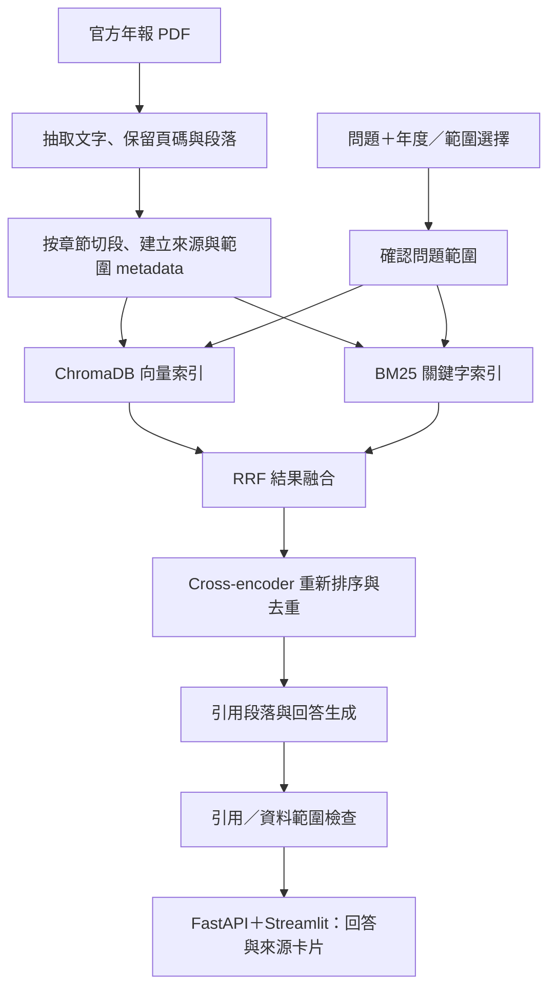

# Banking Reports & Digital Strategy RAG Assistant

規劃日期：2026-10-24。第一階段已開始；目前已取得來源及初步開發題，尚未建立 RAG 應用或執行模型評估。實際進度見 PHASE1_STATUS.md。

## 1. 題目與用途

英文名稱：**Banking Reports & Digital Strategy RAG Assistant — JPMorganChase Case Study**。

中文名稱：**銀行年報與數位策略助手：以 JPMorganChase／Chase 為例**。

做一個能查詢官方年報、比較不同報告年度，並提供逐項證據的 Python AI 應用。主要使用者是需要閱讀企業數位策略、科技投資與營運風險揭露的研究／產品／工程人員。

作品重點：文件處理、檢索品質、可核對的引用、年份與業務範圍辨識、API、測試及可重現執行。與既有 Unity／LLM 畢業專題形成互補。

## 2. Chase 可以選，但要定義範圍

第一版使用 JPMorganChase 集團 2024、2025 年報。重點閱讀集團科技／AI／風險揭露及 Chase 消費金融相關段落。

回答必須區分：

- JPMorganChase 集團層級。
- 美國 Chase／Consumer & Community Banking（CCB）相關範圍。
- Chase U.K.／International Consumer Banking（ICB）相關範圍。
- 原文同時涵蓋多個範圍，或未明示的範圍。

2025 年報的 Marianne Lake 信件在 CCB 章節中另外討論 ICB，明確說兩者策略不同；完整年報註腳亦說明 international consumer initiatives 的財務列報範圍。因此不能只用章節標題判定段落適用哪個業務，也不能將 CCB 的美國數字套用到英國。

資料充足時回答 Chase UK 問題；跨年比較若其中一年沒有足夠證據，明示缺口。起步時逐頁核對 UK 相關內容，不預設兩年揭露完全對稱。集團科技方向也不能直接視為 Chase UK 已採用的技術。

第一版對模糊的「Chase 有多少客戶？」要求選擇市場／業務範圍與報告年度，避免自行猜測。

## 3. 資料來源與版本

| 來源 | 用途 | 官方連結 |
| --- | --- | --- |
| 2024 JPMorganChase 完整年報 | 第一個報告年度，保留全文作為語料候選 | https://www.jpmorganchase.com/content/dam/jpmc/jpmorgan-chase-and-co/investor-relations/documents/annualreport-2024.pdf |
| 2025 JPMorganChase 完整年報 | 第二個報告年度及跨年比較 | https://www.jpmorganchase.com/content/dam/jpmc/jpmorgan-chase-and-co/investor-relations/documents/annualreport-2025.pdf |
| 2024 Chairman and CEO Letter | 官方 HTML 對照，確認段落與發布時間 | https://www.jpmorganchase.com/ir/annual-report/2024/ar-ceo-letters |
| 2024 Marianne Lake Letter | CCB 主題閱讀與抽取核對 | https://www.jpmorganchase.com/ir/annual-report/2024/ar-ceo-letter-marianne-lake |
| 2025 Marianne Lake Letter | CCB／ICB、Chase UK、數位策略閱讀與抽取核對 | https://www.jpmorganchase.com/ir/annual-report/2025/ar-ceo-letter-marianne-lake |

2024 CEO 信件頁標示發布日為 2025-04-07；2025 Marianne Lake 信件頁標示發布日為 2026-04-06。這些是相應網頁的發布日期，不能不經確認就填成每個 PDF 的發布日期。

資料處理規則：

1. 保存來源 URL、擷取日期、檔案 SHA-256、文件名稱與報告年度，建立固定語料版本。
2. PDF 與對應 HTML 不當成兩份獨立證據重複索引；第一版以 PDF 為引用主體，HTML 作抽取核對。
3. 先檢查 CEO／CCB／ICB 相關敘述和科技、營運風險章節；實際納入哪些頁，在來源清單中明示。
4. 公開程式庫優先放下載流程、來源清單與自己的程式；年報原檔和索引留在本機資料目錄，公開材料範圍於發布前確認。

## 4. 第一版功能與界線

### 必須完成

- 英文問題與英文回答；介面能選報告年度及集團／美國／英國範圍。
- 單一報告查詢：從文件取出事實、數位策略與科技應用的描述。
- 雙年度比較：分別找兩年的證據，再比較原文有何變化。
- 每個主要事實附來源卡片：文件、報告年度、業務範圍、頁碼、原文短摘及官方連結。
- 點選引用能到正確文件和 PDF 頁面；標示 PDF 頁碼與文件印刷頁碼的差別。
- 無資料時表示證據不足；只有一年有資料時提供部分答案並標出缺失年份。
- 保留數字的單位、指標名稱與統計期間，避免把相似指標直接比較。
- 顯示檢索／生成耗時；錯誤時提供可理解的訊息。

### 第一版先限制

- 主題以數位銀行、AI／資料／雲端、科技與營運風險的文字揭露為主。
- 財務表格自動推理、複雜計算、投資判斷、多銀行排名與即時新聞留待後續。
- LoRA、agent、多語言、3D 視覺化和公有雲多使用者部署列為擴充項。

報告未提到某件事，不代表該銀行沒有做；跨年度原文措辭不同，也不自動代表實際成效提高。

## 5. 展示情境

以下是預定測試問題，答案需在建置時由人工核對原文，並非目前已驗證的系統輸出：

1. 「2025 年報如何描述 Chase UK 與雲端平台的關係？」
2. 「2024 與 2025 年報如何描述 AI 在消費金融的應用？各列出證據。」
3. 「某一數位客戶指標在兩年的揭露有何變化？指標定義是否相同？」
4. 「Chase 有多少使用者？」——先確認英國／美國、指標及年度。
5. 「年報是否揭露 Chase UK 使用哪個內部 LLM 型號？」——依語料決定能否回答，不能靠常識補出品牌或型號。
6. 「2026 年目前的 Chase UK 客戶數是多少？」——說明固定語料與目前時點的差異，不能把 2025 年報數字包裝成即時數字。

## 6. 建議架構

核心架構參考 arXiv RAG 專案；資料、問題、評估與年度／市場處理依本專案設計。

先交付「向量檢索 → 回答」基準版，再逐項加入 BM25／RRF 與 reranker，量測改善幅度。比較模式也能切回基準版本。

| 部分 | 建議選擇 | 學習／展示目的 |
| --- | --- | --- |
| 主語言 | Python | 資料流程、服務和評估 |
| 文件處理 | PyMuPDF 或 pymupdf4llm，先抽樣驗證後定案 | 處理多欄、頁首頁尾與頁碼 |
| Embeddings／LLM | 優先評估 Ollama 本機方案，保留模型介面 | 模型／硬體可替換，記錄確切版本 |
| 向量資料庫 | ChromaDB | 儲存與檢索文字向量及 metadata |
| 混合搜尋 | BM25＋Reciprocal Rank Fusion | 保留術語、縮寫與精確匹配 |
| 重新排序 | Cross-encoder | 衡量品質與延遲取捨 |
| API／驗證 | FastAPI＋Pydantic | 明確定義請求、回答、引用及錯誤格式 |
| 介面 | Streamlit | 快速展示可核對的問答與雙年比較 |
| 測試／CI | pytest＋GitHub Actions | 自動檢查解析、範圍、檢索、引用及 API |
| 執行環境 | Docker Compose | 重現應用服務；本機模型服務的連線另列說明 |

起步時先核對 Mac 型號、記憶體與可用空間，再選生成／embedding／reranker 模型及大小。規劃不代表已下載模型或啟用付費服務。第一版也不需要購買 GPU。

### 每段文字的必要資料

`document_id`, `source_url`, `document_sha256`, `report_year`, `publication_date`（已知才填）, `retrieved_at`, `pdf_page_index`（0 起算）, `pdf_page_number`（1 起算）, `printed_page_label`, `section_path`, `chunk_id`, `chunk_text`, `entity_scope`, `geography`, `scope_evidence`。

`entity_scope` 可為 group、Chase_US、Chase_UK、ICB、mixed 或 unspecified；不明確時保留 unspecified。同一頁可包含不同業務的段落，因此標籤需有依據，不能全部繼承章節標題。

UI 的「報告年度」與內文的「數字統計年度／期間」分開。2025 年報可能同時引用 2024 年數字、較早期基準和未來計畫。比較模式應保留兩邊各自的檢索額度，避免較容易找到的一年佔滿所有候選段落。

## 7. 評估設計

建立約 50 題人工核對的問題：20 題開發集、30 題保留測試集。每題記錄所問範圍、報告年度、預期證據段落／頁碼、應回答或應釐清／拒答，以及答案核對重點。

測試集分配建議：10 題單一事實、6 題雙年度比較、6 題策略整理、4 題語料不足、4 題業務／年份歧義。避免同一題的改寫分別出現在開發與測試集。若某類資料不足，調整分配並在測試前固定版本。

先固定問題與人工答案，再調參。最終測試不拿來反覆挑設定。評估檔案與答案不能加入檢索索引。測試後若修正 ground truth 或加入資料，使用新版本並重跑所有比較組。

公平比較三種設定：

1. 向量搜尋。
2. 向量＋BM25＋RRF。
3. 混合搜尋＋reranker。

保持語料、問題、回答模型、prompt、最終引用段數及 context token 預算一致；廣泛候選的取得方式可因方法不同而不同，但要記錄。使用相同 embedding 與可比硬體，記錄冷啟動／暖啟動條件。

| 檢查項目 | 如何判斷 |
| --- | --- |
| 檢索證據涵蓋 | 最終候選是否包含人工標示的必要證據；雙年問題逐年計分 |
| 回答正確性 | 人工核對內容、數字、期間、單位及業務範圍 |
| 引用有效性 | 引用存在，連結及頁碼能指向正確位置 |
| 引用支持程度 | 該段原文是否真的支持回答的相關主張 |
| 證據不足／歧義處理 | 分開衡量該拒答是否拒答、可回答題是否被錯誤拒答、該釐清時是否釐清 |
| 效能 | 記錄檢索、reranking、生成耗時；報告中位數與高延遲案例 |
| 執行成本 | 本機記錄模型與硬體；若使用 API 則記錄 token 用量與實際成本 |

不把「回答有引用」等同「回答正確」。不預先承諾命中率或把小樣本當生產等級證明。自動語意分數只作輔助，不能取代數字與證據人工核對。

## 8. 階段、工時與完成條件

以下為邊學邊做、由 Codex 協助的規劃估算。主線約 70–120 小時，每週約 12 小時，抓 6–10 週；資料抽取或硬體限制可能延長時間。

| 階段 | 工時估算 | 完成條件 |
| --- | --- | --- |
| 1. 定義問題與來源 | 6–10 小時 | 定義集團／美國／英國範圍；來源可取得；列出 10 個典型問題 |
| 2. 抽取、切段及 metadata | 10–16 小時 | 固定兩年語料；抽樣原文與頁碼能對回 PDF；建立 chunk ID 與來源清單 |
| 3. 基準 RAG | 14–20 小時 | 英文問題可檢索、回答並附來源；同年度／雙年度路徑可操作 |
| 4. 評估集與範圍檢查 | 10–16 小時 | 約 50 題人工核對、開發／測試切分固定；基準報告可重跑 |
| 5. 混合搜尋與 reranking | 12–20 小時 | 三種設定公平比較；能說明改善、退步及延遲；選定預設設定 |
| 6. API、介面及工程收尾 | 14–24 小時 | FastAPI／Streamlit、來源卡片、錯誤處理、測試、Docker 及 CI 可操作 |
| 7. 文件與展示 | 4–10 小時 | README、架構圖、結果表、失敗案例及約 2–3 分鐘示範 |

階段總和為 70–116 小時，預算取整為 70–120 小時。硬體查核與試抽取後再修正估算。面試／測評週可減少開發量，無須為趕時程一次加入所有擴充功能。

## 9. 最終交付與驗收

- 從乾淨環境依 README 可安裝、建立索引、啟動服務及執行測試；首次模型下載需求另列。
- 所有納入的 chunk 均有可追溯文件 ID、URL、報告年度和 PDF 頁碼。
- 引用格式、文件／頁碼存在性及所選來源範圍的自動檢查通過。
- 已人工核對最終保留測試集的答案與引用，發布實際結果及分母，列出失敗案例。
- 預設展示案例不混用集團／美國／英國、不同指標或不同期間；歧義與缺失案例有清楚行為。
- 附三種檢索設定的比較，不要求每種新增方法都一定改善。
- GitHub 保留有意義的開發歷程，記錄你自己做出的設計決定及參考來源。
- 求職說明只寫實際完成的功能和測得結果；不把規劃中的功能提前寫進 CV。

第一版達到以上條件即可成為可展示成果。第二版再選財務表格、更多銀行、串流或微調中的一項，以具體需求和評估結果決定。

## 10. 開始開發時的第一個工作包

1. 建立獨立專案資料夾與 Git repository，名稱建議 `banking-reports-rag`。目前規劃已移入獨立專案 docs 目錄。
2. 核對硬體、Python／Docker／Ollama 環境，再選模型與版本。
3. 取得兩份年報，記錄 SHA-256 與來源，人工標出代表性頁面。
4. 用少量頁面試抽取，確認多欄、年份、來源範圍與頁碼處理。
5. 建立最初 10 題開發題及正確證據，再進入基準版開發。

上述第一階段工作包的實際完成狀態見 PHASE1_STATUS.md；後續階段依計畫逐步進行。

## 參考架構

- [arXiv RAG System](https://github.com/choeyunbeom/arxiv_rag_system)
- [其檢索實驗與評估限制](https://github.com/choeyunbeom/arxiv_rag_system/blob/main/docs/retrieval_optimisation.md)
- [JPMorganChase 2025 CCB／ICB 官方說明](https://www.jpmorganchase.com/ir/annual-report/2025/ar-ceo-letter-marianne-lake)

來源核對日期為 2026-10-24。網站或文件後續可能更新，建置時以實際取得檔案版本及來源清單為準。
